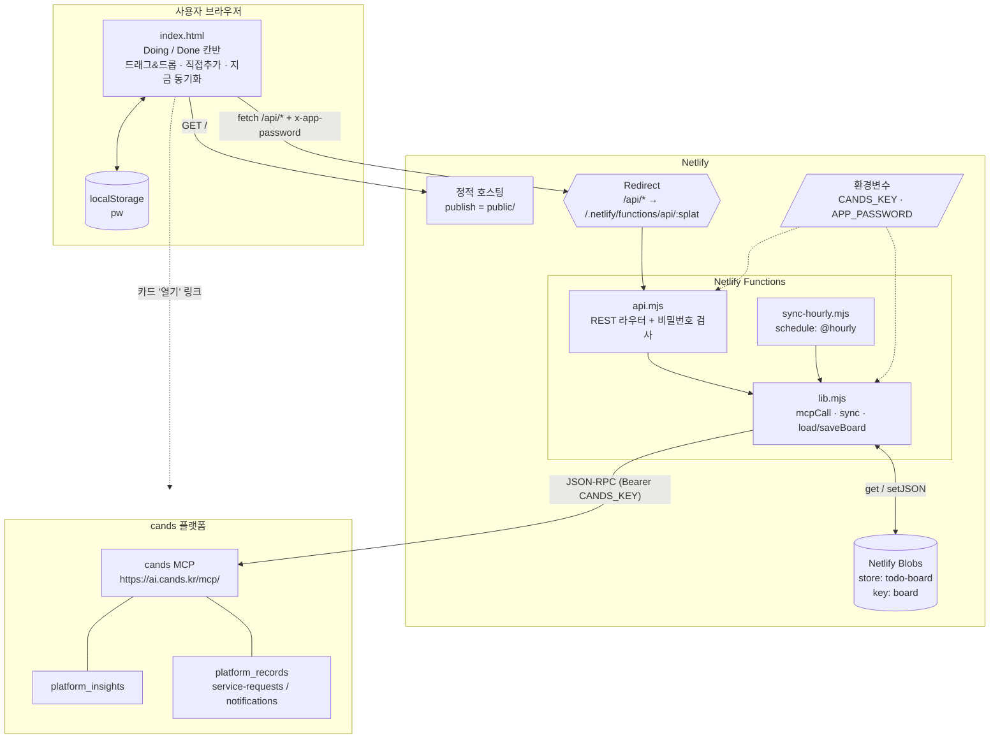
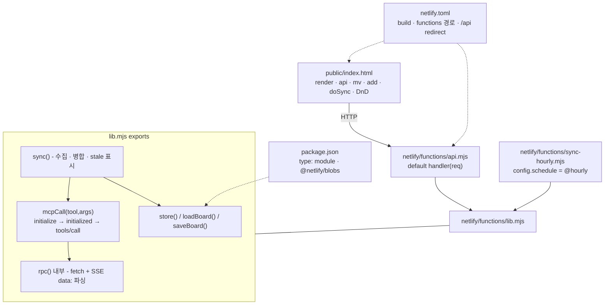
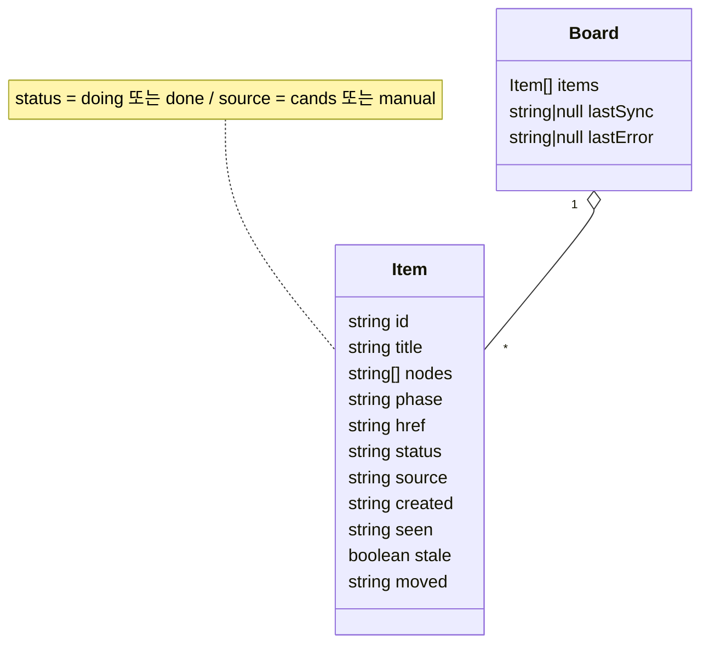
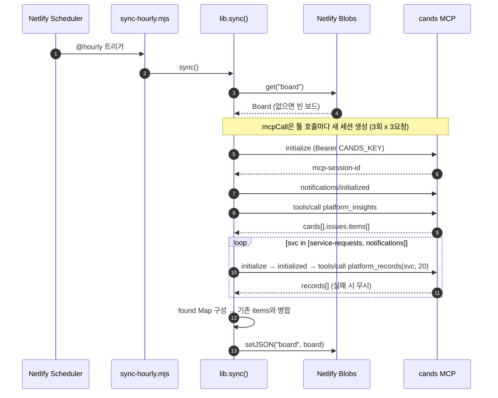
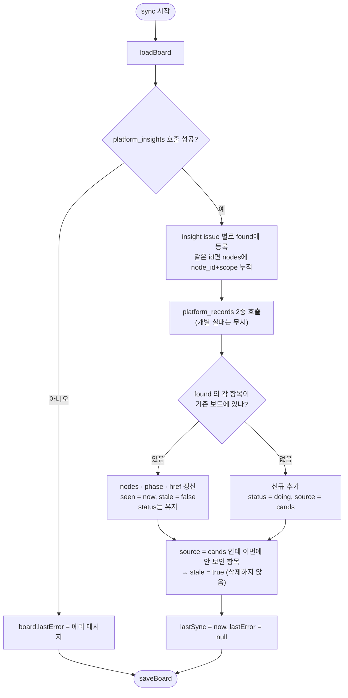
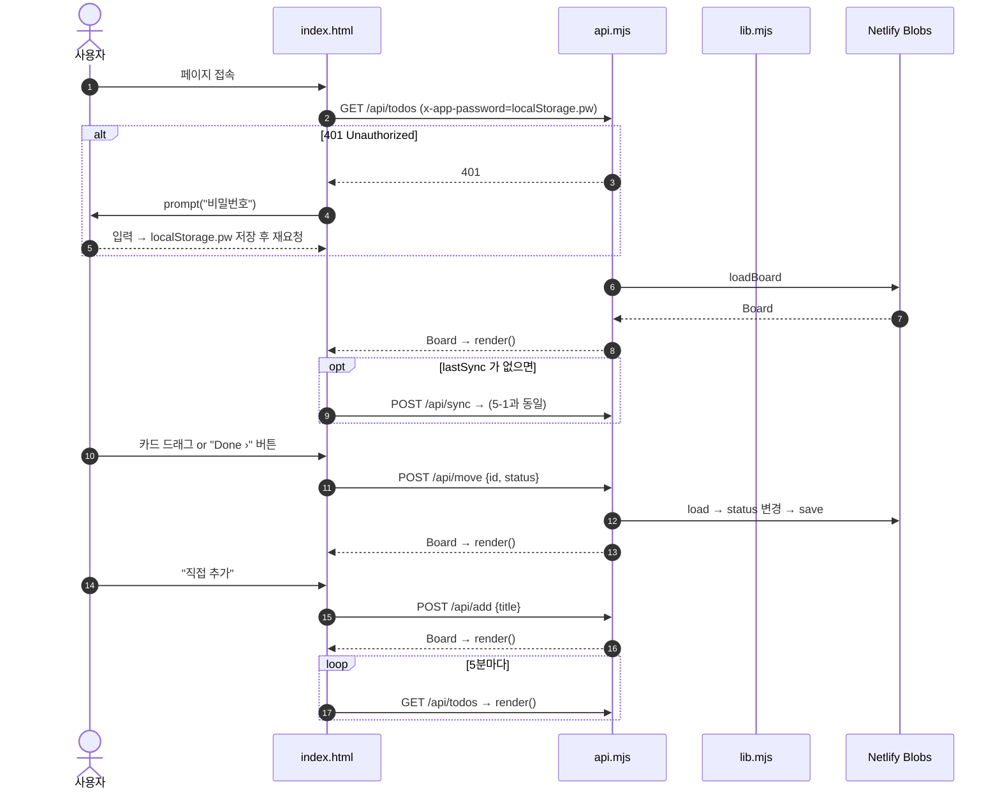
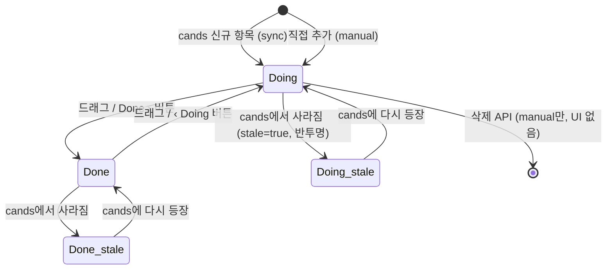
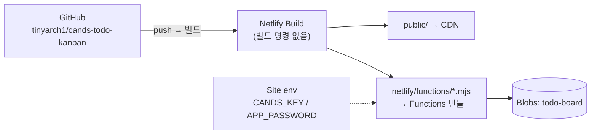

# cands Todo Kanban - 전체 아키텍처 구성도 및 흐름도

> 기준 커밋: `main` (2026-10-28, 8개 파일) / 분석: 코드 정적 분석 기반

## 0. 한 줄 요약
cands MCP(`ai.cands.kr/mcp/`)의 SCM 연결 이슈를 **Netlify Scheduled Function이 매시 정각 조회**해 **Netlify Blobs**에 저장된 보드에 병합하고, 정적 웹페이지(`public/index.html`)에서 **Doing / Done** 2열 칸반으로 관리하는 서버리스 웹앱.

| 구분 | 기술 |
|---|---|
| Frontend | Vanilla HTML/CSS/JS 단일 파일 (`public/index.html`), 프레임워크 없음 |
| Hosting | Netlify (정적 publish: `public/`) |
| Backend | Netlify Functions (ESM `.mjs`) - `api.mjs`(REST), `sync-hourly.mjs`(Scheduled `@hourly`) |
| Storage | Netlify Blobs - store `todo-board`, key `board` (단일 JSON 문서) |
| 외부 연동 | cands MCP (JSON-RPC 2.0 over Streamable HTTP, `Bearer CANDS_KEY`) |
| 인증 | 공유 비밀번호 `APP_PASSWORD` → 요청 헤더 `x-app-password` |
| 의존성 | `@netlify/blobs ^8.1.0` |

---

## 1. 전체 아키텍처 구성도

## 2. 소스 구성도 (모듈 의존 관계)

## 3. REST API 명세 (`api.mjs`)

모든 요청은 `APP_PASSWORD`가 설정된 경우 `x-app-password` 헤더 일치 필요 (불일치 시 `401`).

| Method | Path | Body | 동작 | 응답 |
|---|---|---|---|---|
| GET | `/api/todos` | - | 보드 조회 | Board |
| POST | `/api/sync` | - | 즉시 cands 동기화 | Board |
| POST | `/api/move` | `{id, status}` | 상태 변경 (`doing`/`done`), `moved` 시각 기록 | Board |
| POST | `/api/add` | `{title}` | 수동 카드 추가 (`manual:<ts>`, 200자 제한, Doing) | Board |
| POST | `/api/delete` | `{id}` | 수동 카드만 삭제 (UI 미노출) | Board |
| * | 그 외 | - | - | `404 {error:"not found"}` |

## 4. 데이터 모델 (Netlify Blobs `todo-board/board`)

| id 규칙 | 출처 | title | phase |
|---|---|---|---|
| `<issue id>` | `platform_insights` cards[].issues.items[] | id 그대로 | state 매핑 plan→계획, do→실행, check→점검, act→조치 |
| `service-requests:<id or title>` | `platform_records(service-requests, limit 20)` | rec.title | rec.status |
| `notifications:<id or title>` | `platform_records(notifications, limit 20)` | rec.title | rec.status |
| `manual:<epoch ms>` | 사용자 직접 추가 | 입력값 (≤200자) | "" |

---

## 5. 흐름도

### 5-1. 정기 동기화 (매시 정각) 시퀀스

### 5-2. 병합(merge) 로직 순서도

### 5-3. 사용자 화면 흐름 시퀀스

### 5-4. 카드 상태 전이도

---

## 6. 배포/설정 구성

| 항목 | 값 |
|---|---|
| publish | `public` |
| functions | `netlify/functions` |
| redirect | `/api/*` → `/.netlify/functions/api/:splat` (200 rewrite) |
| schedule | `sync-hourly.mjs` → `@hourly` |
| 필수 env | `CANDS_KEY` (cands MCP 개인 키) |
| 선택 env | `APP_PASSWORD` (미설정 시 인증 없음) |

## 7. 분석 중 확인된 주요 관찰 사항 (개선 이슈로 별도 등록)
1. 카드 렌더링 `onclick="mv('${esc(i.id)}', ...)"` 에서 `esc()`가 작은따옴표(`'`)를 이스케이프하지 않음 → 깨짐/XSS 위험
2. 단일 Blob 문서 read-modify-write → 정기 동기화와 사용자 조작이 겹치면 변경 유실 가능
3. 401 시 `prompt` 취소하면 빈 비밀번호로 무한 재귀 / 비밀번호 평문 localStorage 저장
4. `mcpCall` 이 툴마다 세션 재생성(동기화 1회당 9 요청), 타임아웃·재시도 없음, `platform_records` 실패는 조용히 무시
5. insights 카드 title이 이슈 ID만 표시, 수동 카드 삭제/편집 UI 없음, stale 항목 정리 기능 없음
